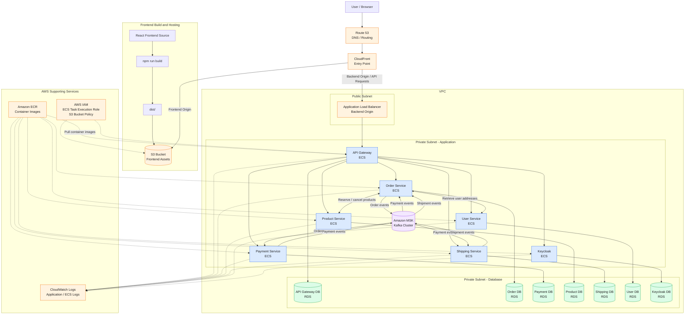

# Online Shop — AWS Infrastructure with LocalStack

Infrastructure and deployment configuration for the Online Shop microservices application, using LocalStack to develop and test an AWS-based environment locally.
The project brings together the frontend, backend microservices, databases, messaging infrastructure, and AWS-related resources required to run the application in a local environment.

Directory:
[Architecture](#architecture)
[Technology Stack](#technology-stack)
[Repository Structure](#repository-structure)
[Prerequisites](#prerequisites)
[Getting Started](#getting-started)
[Deploy AWS Resources](#deploy-aws-resources)
[Configuration](#configuration)
[Verification](#verification)
[Troubleshooting](#troubleshooting)
[License](#license)


## Architecture

The application consists of a React frontend, a Spring Boot microservices backend, PostgreSQL databases, Kafka, and Keycloak. AWS infrastructure configuration provides the hosting, routing, and supporting resources.

### Architecture Diagram




## Technology Stack

- **AWS CLI** — Command-line interface for configuring, deploying, managing, and troubleshooting AWS resources and infrastructure
- **LocalStack** — Local AWS service emulation
- **Amazon S3** — Frontend asset and static website storage
- **Amazon CloudFront** — Content delivery and request routing configuration
- **CloudFront Functions** — Request rewriting and edge logic
- **AWS Application Load Balancer (ALB)** — Distributes incoming HTTP/HTTPS traffic across backend services running on ECS and routes requests to the appropriate targets
- **Amazon ECS** — Container task definitions for backend services and infrastructure components
- **Amazon ECR** — Container image storage and versioning
- **Amazon EC2** — Virtual server infrastructure and networking configuration, including VPCs, subnets, and security groups
- **Amazon RDS** — Managed relational database hosting
- **Amazon Route 53** — DNS configuration
- **AWS IAM** — Task execution and resource permissions
- **Amazon MSK (Managed Streaming for Apache Kafka)** — Managed Kafka clusters for event-driven communication between backend microservices
- **Amazon CloudWatch Logs** — Centralized application and container logging
- **AWS Security** — Access control
- **AWS Secrets Manager** — Secure storage, management, and retrieval of sensitive information, such as database credentials, API keys, and application secrets


## Repository Structure

```text
cloudfront/
├── cloudfront/
│   ├── bucket-policy.json
│   ├── cf-response.json
│   ├── distribution-config.json
│   ├── distribution.json
│   ├── function-config.json
│   ├── oac-config.json
│   └── rewrite-be.js
├── db-volume-dump/
│   ├── auth-token-db.dump
│   ├── keycloak-db.dump
│   ├── order-service-db.dump
│   ├── payment-service-db.dump
│   ├── product-service-db.dump
│   ├── shipping-service-db.dump
│   └── user-service-db.dump
├── iam/
│   └── ecs-task-execution-trust-policy.json
├── kafka/
│   ├── broker-node-group-info.json
│   └── kafka-logging-info.json
├── route53/
│   └── delete-bad-keycloak-record.json
├── task-definition/
│   ├── backup/
│   ├── api-gateway-task-definition.json
│   ├── keycloak-task-definition.json
│   ├── my-task-definition.json
│   ├── order-service-task-definition.json
│   ├── payment-service-task-definition.json
│   ├── product-service-task-definition.json
│   ├── shipping-service-task-definition.json
│   └── user-service-task-definition.json
├── volume/
├── .gitignore
└── LICENSE
```

### Directory Responsibilities

| Directory                 | Purpose                                                                                                 |
|---------------------------|---------------------------------------------------------------------------------------------------------|
| `cloudfront/`             | CloudFront distribution configuration, S3 access policies, origin access control, and request rewriting |
| `db-volume-dump/`         | PostgreSQL database dumps for restoring application data                                                |
| `iam/`                    | IAM trust policies for ECS task execution                                                               |
| `kafka/`                  | Kafka-related configuration and resource information                                                    |
| `route53/`                | Route 53 DNS-related configuration and operations                                                       |
| `task-definition/`        | ECS task definitions for the API Gateway, microservices, and Keycloak                                   |
| `task-definition/backup/` | Deprecated files                                                                                        |


## Prerequisites

Install the tools required by your deployment workflow:

- [Docker](https://www.docker.com/)
- [LocalStack](https://docs.localstack.cloud/)
- [AWS CLI](https://aws.amazon.com/cli/)

Ensure Docker is running and that the LocalStack endpoint is reachable.


## Getting Started

### 1. Clone the Repository

```bash
git clone https://github.com/yutojama/online-shop-aws.git
```

### 2. Start LocalStack

Start LocalStack using your existing Docker Compose configuration or your preferred LocalStack setup.

In this project makes use of the compose file in root:

```bash
docker compose up -d
```

Check that the LocalStack container is running:

```bash
docker ps
```

### 3. Configure AWS CLI Access

Configure credentials and default resion:

```bash
aws configure
```

If prompts you for

```bash
AWS Access Key ID:
AWS Secret Access Key:
Default region name: 
Default output format: json
```

For Localstack, set up credentials as following:
AWS Access Key ID: test
AWS Secret Access Key: test

The default region is eu-central-1 for example. You can randomly pick one with your preference.


## Deploy AWS Resources

Use your deployment scripts or AWS CLI commands to create the required resources.
You can also use IaC (AWS CloudFormation or CDK) to deploy the resources. At present, this project does not include any IaC deployment.

A typical deployment sequence is:

1. [Create required networking and supporting resources.](#1-create-network-and-supporting-resources)
2. [Push images to ECR.](#2-push-images-to-ecr)
3. [Create S3 buckets and upload images and frontend.](#3-create-s3-buckets-and-upload-images-and-frontend)
4. [Create RDS database instances and Kafka with KMS.](#4-create-rds-database-instances-and-kafka-with-kms) 
5. [Restore databases when required.](#5-restore-databases-when-required)
6. [ECS task definitions and start the application tasks.](#6-ecs-task-definitions-and-start-the-application-tasks)
7. [Create WatchLogs and verify application connectivity and request routing.](#7-create-watchlogs-and-verify-application-connectivity-and-request-routing)
8. [Configure CloudFront origins, access controls, distributions, and functions.](#8-configure-cloudfront-origins-access-controls-distributions-and-functions)
9. [Set up loadbalancer for backend api-gateway.](#9-set-up-loadbalancer-for-backend-api-gateway)
10. [Configure Route 53 records if supported by your LocalStack setup.](#10-check-if-there-is-incorrect-routing-in-route-53)

The exact sequence depends on the dependencies between your resources. Use the commands and resource identifiers defined by your existing configuration.

### 1. Create Network and supporting resources

Check VPC:
```bash
aws ec2 describe-vpcs
```

Then create private subnets for microservices and databases.
The cider blocks of default public networks are like:
```text
172.31.0.0/20
172.31.16.0/20
172.31.32.0/20
```

For this project, I will take the following cider blocks for private subnets for database:
```text
172.31.48.0/24
172.31.49.0/24
```

And the following for microservices:
```text
172.31.50.0/24
172.31.51.0/24
```

Create all subnets one by one with a different availability zone:
```bash
aws `
 create-subnet `
 --vpc-id vpc-xxx `
 --cidr-block xxx `
 --availability-zone eu-central-1x
```

Create private route table and associate it to both app and db subnets.
Since a newly created route table does not allocate 0.0.0.0 by default, it is automatically private.

```bash
aws ec2 create-route-table --vpc-id vpc-xxx
```

```bash
aws ec2 associate-route-table `
  --route-table-id rtb-xxx `
  --subnet-id subnet-xxx `
  --region eu-central-1
```

Create subnet group for app and db subnets:
```bash
aws -local rds create-db-subnet-group 
--db-subnet-group-name db-subnets 
--db-subnet-group-description "Private subnets for database" 
--subnet-ids subnet-aaaa subnet-bbbb
```

### 2. Push images to ECR.

Create repository for each docker image:
```bash
aws ecr create-repository `
  --repository-name repo_name
```

Tag docker image with the localstack ECR instruction:
```bash
docker tag `
  docker_image:<VERSION> `
  000000000000.dkr.ecr.eu-central-1.localhost.localstack.cloud:4566/docker_image:<VERSION>
```

Push image to docker:
```bash
docker push 000000000000.dkr.ecr.eu-central-1.localhost.localstack.cloud:4566/docker_image:<VERSION>
```

### 3. Create S3 buckets and upload images and frontend

Create s3 bucket
```bash
aws s3 mb s3://portshop-bucket --region eu-central-1
```

Create a path for images:
```bash
aws s3api put-object \
  --bucket portshop-bucket \
  --key images/
```

Create a path for frontend:
```bash
aws s3api put-object \
  --bucket portshop-bucket \
  --key frontend/
```

Upload resources in the current directory
the option --delete deletes all files not matching your resource folder
```bash
aws s3 sync .\resource\ s3://portshop-bucket/resource --delete
```

### 4. Create RDS database instances and Kafka with KMS.

Create a security group for each RDS instance:
```bash
aws ec2 create-security-group `
 --group-name xxx-db-sg `
 --description "Security group for xxx-db" `
 --vpc-id vpc-xxx
```

Create RDS instance for each database.
The option --multi-az ensures that your database instance replicas can be deployed across availability zones.
The option --no-publicly-accessible ensures that the database won't have a publicly accessible network endpoint.
```bash
aws rds create-db-instance `
  --db-instance-identifier xxx-db `
  --db-instance-class db.t3.micro `
  --engine postgres `
  --engine-version xx.x `
  --master-username username `
  --master-user-password "password" `
  --allocated-storage 20 `
  --storage-type gp3 `
  --port 5432 `
  --db-name db `
  --db-subnet-group-name xxx-db-subnets `
  --vpc-security-group-ids sg-xxx `
  --multi-az `
  --no-publicly-accessible
```

To create replicas:

```bash
aws rds create-db-instance-read-replica \
  --db-instance-identifier mydb-replica-1 \
  --source-db-instance-identifier xxx-db \
  --region eu-central-1
```

Create MSK cluster:
The files required are placed under kafka folder

```bash
aws kafka create-cluster `
  --cluster-name "kafka" `
  --broker-node-group-info file://kafka/broker-node-group-info.json `
  --kafka-version "3.6.0" `
  --number-of-broker-nodes 2 `
  --enhanced-monitoring "DEFAULT" `
  --logging-info file://kafka/kafka-logging-info.json
```

Get brokers for further use by ecs tasks:

```bash
aws kafka list-clusters

aws kafka get-bootstrap-brokers `
  --cluster-arn arn:aws:kafka:eu-central-1:000000000000:cluster/portshop-kafka/xxx
```

### 5. Restore databases when required

Create dump file for the original local database:
```bash
docker exec xxx-db-container_name pg_dump `
-U username `
-d db `
-F c `
-f /tmp/xxx-db.dump
```

Copy dump out from container:
```bash
docker cp xxx-db-container_name:/tmp/xxx-db.dump .\xxx-db.dump
```

Restore data volume for RDS. This is only applicable for localstack. In the background, localstack uses docker containers to simulate rds. Therefore, it is possible to directly scout and edit database through docker internal network.
The option -p is the port, on which localstack exposes your database.
You can either log into the port or use any postgres UI to verify the restoration.
```bash
docker run --rm -it `
-v "${PWD}:/backup" `
-e PGPASSWORD="YOUR_PASSWORD" `
postgres:18.6 `
pg_restore `
-h host.docker.internal `
-p 4721 `
-U username `
-d db `
--clean `
--if-exists `
/backup/xxx-db.dump
```

### 6. ECS task definitions and start the application tasks.

ECS task will be created for:
- keycloak
- api-gateway
- order-service
- payment-service
- product-service
- shipping-service
- user-service

Create ECS cluster:
```bash
aws ecs create-cluster `
  --cluster-name portshop
```

Create security groups
```bash
aws ec2 create-security-group `
 --group-name xxx-service-sg `
 --description "Security group for xxx-service" `
 --vpc-id vpc-xxx
```

Set up database access rule for each ecs security group:
```bash
aws ec2 authorize-security-group-ingress `
  --group-id sg-xxx-database `
  --protocol tcp `
  --port 5432 `
  --source-group sg-xxx-service
```

Create and apply trust policy, only required once for all ecs tasks:
```bash
aws iam create-role `
  --role-name ecsTaskExecutionRole `
  --assume-role-policy-document file://iam/-task-execution-trust-policy.json
  
aws iam attach-role-policy `
  --role-name ecsTaskExecutionRole `
  --policy-arn arn:aws:iam::aws:policy/service-role/AmazonECSTaskExecutionRolePolicy
```

register task definition:
```bash
aws-local ecs register-task-definition `
  --cli-input-json file://task-definition/keycloak-task-definition.json
```

**NOTICE:** Normally you will need AWS Secrets Manager for credentials:
```bash
aws secretsmanager create-secret `
  --name portshop/xxx-service/db `
  --description "xxx-service database credentials" `
  --secret-string '{"username":"your_username","password":"your_password"}'

aws secretsmanager describe-secret `
  --secret-id portshop/xxx-service/db `
  --query ARN `
  --output text
```

And in task-definition.json:
```text
"secrets": [
        {
          "name": "DB_USERNAME",
          "valueFrom": "arn:aws:secretsmanager:eu-central-1:123456789012:secret:online-shop/postgres-credentials-AbCdEf:username::"
        },
        {
          "name": "DB_PASSWORD",
          "valueFrom": "arn:aws:secretsmanager:eu-central-1:123456789012:secret:online-shop/postgres-credentials-AbCdEf:password::"
        }
]
```

**HOWEVER**, the secret manager is not accessible with the key pair <valueFrom, ARN>. So the secrets are replaced by environment variables, which should not happen in real deployment for safety reason.

Create dns namespace and cloud map for service discovery:
```bash
aws-local servicediscovery create-private-dns-namespace `
  --name portshop.local `
  --vpc vpc-xxx
  
aws servicediscovery create-service `
  --name xxx-service `
  --namespace-id namespaceId `
  --dns-config "DnsRecords=[{Type=A,TTL=10}],RoutingPolicy=MULTIVALUE"
```

Create ecs service:
```bash
aws ecs create-service `
  --cluster portshop `
  --service-name xxx-service `
  --task-definition xxx-service `
  --desired-count 2 `
  --launch-type FARGATE `
  --network-configuration "awsvpcConfiguration={subnets=[subnet-xxx-a,subnet-xxx-b],securityGroups=[sg-xxx],assignPublicIp=DISABLED}"
  --service-registries "registryArn=service_discovery_registry_arn,containerName=xxx-service,containerPort=8080"
```

To stop ecs tasks:
```bash
aws-local ecs update-service `
  --cluster portshop `
  --service xxx-service `
  --desired-count 0
```

To run change task number:
```bash
aws-local ecs update-service `
  --cluster portshop `
  --service xxx-service `
  --desired-count 3
```

### 7. Create WatchLogs and verify application connectivity and request routing.

You can easily create, review and delete Log Streams in Localstack desktop.

### 8. Configure CloudFront origins, access controls, distributions, and functions.

To make the web accessible with CloudFront, while the s3 bucket stays private, OAC needs to be configured properly:

```bash
aws cloudfront create-origin-access-control --origin-access-control-config file://cloudfront/oac-config.json
```

To host frontend with CloudFront and route for backend, you need to set up distribution:
```bash
aws cloudfront create-distribution `
  --distribution-config file://cloudfront/distribution.json
```

**NOTICE:** distribution.json now contains only s3 bucket as its only origin. To add backend as the second origin, copy the backend origin from distribution-config and paste into distribution.json.

Get domain name to access frontend:
```bash
aws cloudfront get-distribution `
  --id YOUR_DISTRIBUTION_ID `
  --query "Distribution.DomainName" `
  --output text
```

### 9. Set up loadbalancer for backend api-gateway

```bash
aws cloudfront create-origin-access-control --origin-access-control-config file://cloudfront/oac-config.json
```

You may have more than 1 api-gateway task. So that they are recognized by loadbalancer, a target-group is required:
```bash
aws elbv2 create-target-group `
  --name api-gateway-tg `
  --protocol HTTP `
  --port 4000 `
  --target-type ip `
  --vpc-id vpc-xxx `
  --health-check-protocol HTTP `
  --health-check-path api-gateway/actuator/health `
  --query "TargetGroups[0].TargetGroupArn" `
  --output text
```

Create ALB security group:
```bash
aws ec2 create-security-group `
  --group-name alb-sg `
  --description "Security group for gateway ALB" `
  --vpc-id vpc-xxx `
  --query "GroupId" `
  --output text
```

Allow inbound traffic:
```bash
aws ec2 authorize-security-group-ingress `
  --group-id alb-sg `
  --protocol tcp `
  --port 80 `
  --cidr "0.0.0.0/0"
```

Create ALB:
```bash
aws elbv2 create-load-balancer `
  --name api-gateway-alb `
  --type application `
  --scheme internet-facing `
  --ip-address-type ipv4 `
  --subnets subnet-xxx-a subnet-xxx-b `
  --security-groups alb-sg `
  --query "LoadBalancers[0].LoadBalancerArn" `
  --output text
```

Create ALB listener
```bash
aws elbv2 create-listener `
  --load-balancer-arn ALB_ARN `
  --protocol HTTP `
  --port 80 `
  --default-actions "Type=forward,TargetGroupArn=api-gateway-tg" `
  --query "Listeners[0].ListenerArn" `
  --output text
```

Allow traffic from ALB to api-gateway(outbound traffic):
```bash
aws ec2 authorize-security-group-ingress `
  --group-id api-gateway-sg `
  --protocol tcp `
  --port 4000 `
  --source-group alb-sg
```

Attach the target group to the ecs service of api-gateway
```bash
aws ecs update-service `
--cluster portshop `
--service-name api-gateway `
--task-definition api-gateway `
--desired-count x `
--launch-type FARGATE `
--network-configuration "awsvpcConfiguration={subnets=[subnet-xxx-a,subnet-xxx-b],securityGroups=[sg-xxx],assignPublicIp=DISABLED}" `
--service-registries "registryArn=arn:aws:servicediscovery:eu-central-1:000000000000:service/xxx,containerName=api-gateway,containerPort=4000" `
--load-balancers "targetGroupArn=arn:aws:elasticloadbalancing:eu-central-1:000000000000:targetgroup/api-gateway-tg/xxx,containerName=api-gateway,containerPort=4000"
```

Get the ALB DNS name:
```bash
aws elbv2 describe-load-balancers `
  --load-balancer-arns ALB_ARN `
  --query "LoadBalancers[0].DNSName" `
  --output text
```

Check target health:
```bash
aws elbv2 describe-target-health `
  --target-group-arn tg_arn `
  --query "TargetHealthDescriptions[*].{IP:Target.Id,Port:Target.Port,State:TargetHealth.State,Reason:TargetHealth.Reason}" `
  --output table
```

### 10. Check if there is incorrect routing in Route 53.

In localstack, multiple operation on the same ecs service may result in redundant NDS, which will result in 500 server error between services.

To debug if a request error is resulted by incorrect routing:
```bash
docker exec YOUR_CONTAINER_ID sh -c "curl -sv --connect-timeout 3 http://target-service.portshop.local:port/operation"
```

If the result shows any refused connection to a DNS name, delete it:
```bash
aws route53 change-resource-record-sets `
    --hosted-zone-id /hostedzone/xxx `
    --change-batch file://delete-bad-xxx-record.json
```


## Configuration

Review these settings before deploying:

- LocalStack endpoint and service availability
- AWS region
- S3 bucket names
- CloudFront origins and distribution settings
- Route 53 hosted zone and DNS records
- ECS task execution role
- Container image registry and image tags
- PostgreSQL connection details
- Kafka bootstrap addresses
- Keycloak issuer, realm, and client settings
- Frontend and API Gateway URLs

Keep sensitive values in environment variables, local configuration files excluded from Git, or an appropriate secrets manager.


## Verification

After deployment, verify that the required resources exist.

### S3

```bash
awslocal s3 ls
```

### ECS

```bash
awslocal ecs list-clusters
awslocal ecs list-task-definitions
```

### CloudFront

```bash
awslocal cloudfront list-distributions
```

### Route 53

```bash
awslocal route53 list-hosted-zones
```

These commands query resources through the local AWS endpoint. Their availability and results depend on the LocalStack services enabled in your environment.

Also verify that:

- Frontend assets are accessible through the intended URL.
- API requests reach the API Gateway.
- Backend services can communicate with their databases.
- Kafka events can be produced and consumed.
- Keycloak authentication works.
- Logs do not contain unexpected errors.


## Troubleshooting

### Resources are missing

Check LocalStack health, enabled services, resource names, and deployment command output.

### ECS tasks fail to start

Inspect task definitions, container image availability, resource settings, networking, environment variables, and task logs.

### CloudFront requests fail

Check distribution status, origin configuration, S3 permissions, origin access control, cache behavior, and request rewriting.

### Database restoration fails

Check dump format, PostgreSQL version compatibility, database existence, permissions, and available storage.

### Services cannot communicate

Check container networking, DNS names, exposed ports, service discovery configuration, and Kafka bootstrap addresses.


## License

See the [LICENSE](LICENSE) file for licensing information.
